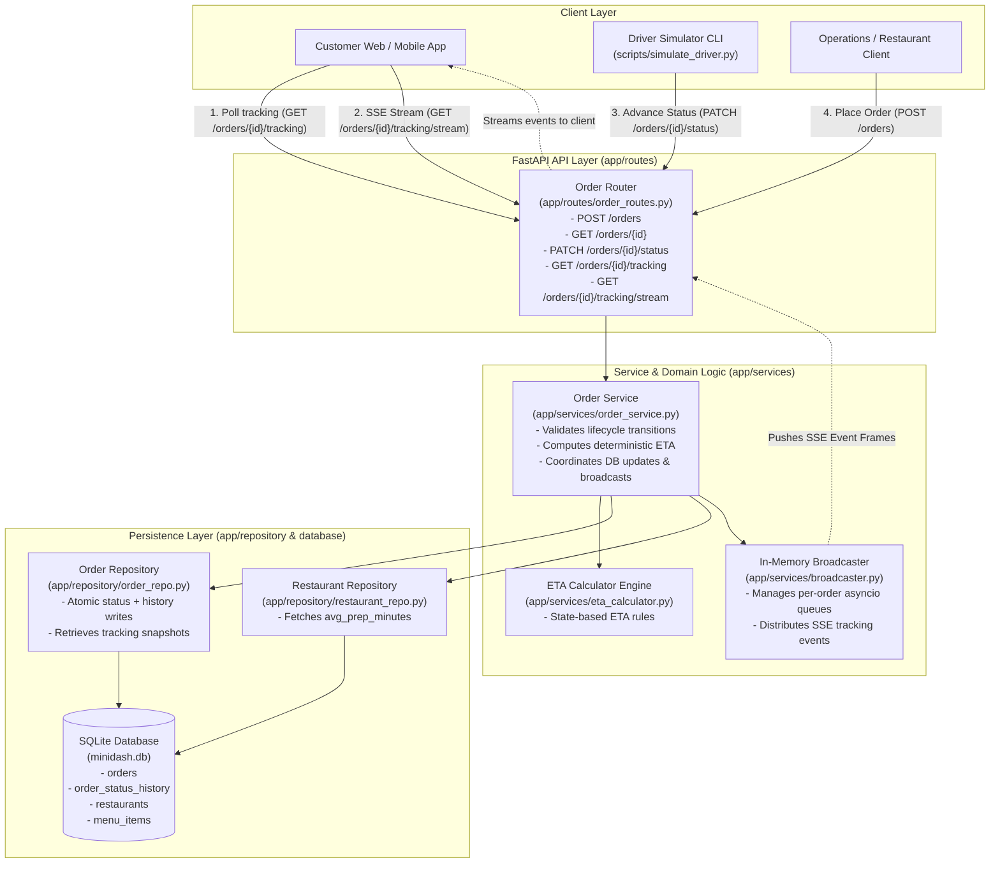
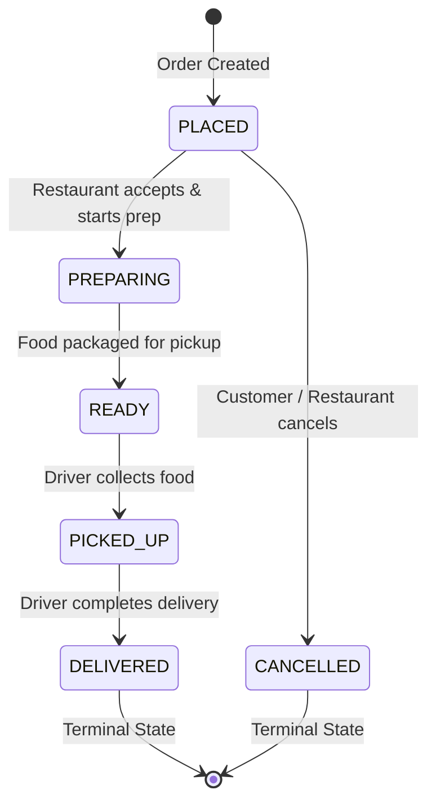
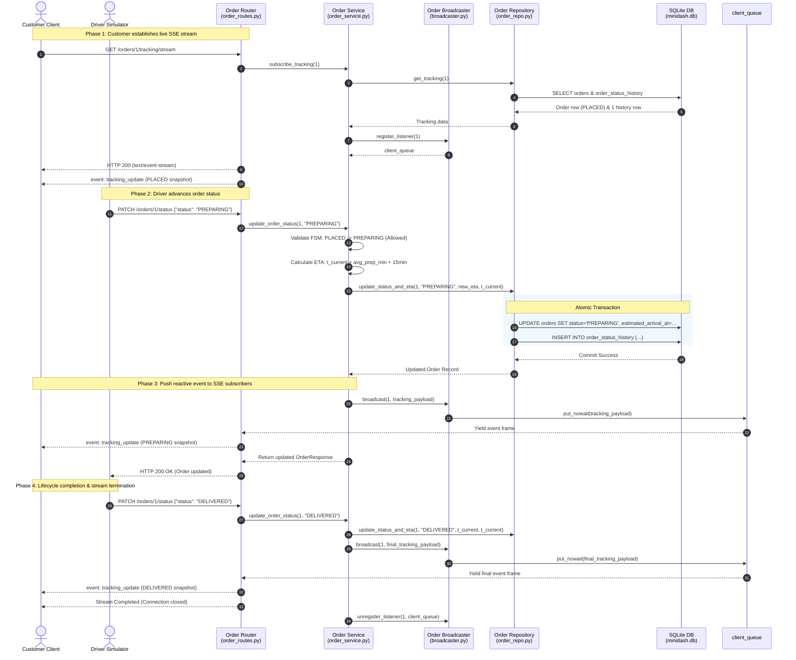

# Architectural Design Document: TrackC — Live Order Tracking (MVP)

**Feature Identifier**: `TrackC`  
**Target Release**: MiniDash v1.1.0  
**Status**: Proposed / Under Review  
**Specification Reference**: [`requirements.md`](requirements.md)  
**Authors**: MiniDash Core Team  

---

## 1. Executive Summary & Architectural Goals

The **TrackC: Live Order Tracking** feature enhances the baseline MiniDash REST API by introducing deterministic real-time tracking of orders from initial placement to delivery.

### Key Capabilities
1. **Finite State Machine (FSM)**: Enforce a strict lifecycle:
   $$\text{PLACED} \longrightarrow \text{PREPARING} \longrightarrow \text{READY} \longrightarrow \text{PICKED\_UP} \longrightarrow \text{DELIVERED}$$
   with `CANCELLED` permitted strictly only while in `PLACED`.
2. **Audit History & Traceability**: Persist an append-only log of every status transition with ISO 8601 UTC timestamps in a dedicated `order_status_history` table.
3. **Deterministic ETA Calculation**: Compute arrival timestamps deterministically from restaurant `avg_prep_minutes` and a standard 15-minute transit window, recomputed at each transition milestone.
4. **Dual Real-Time Consumption**: Support pull-based polling (`GET /orders/{id}/tracking`) and push-based Server-Sent Events (SSE) streaming (`GET /orders/{id}/tracking/stream`).
5. **Driver Advancement Simulator**: Provide an automated CLI utility (`scripts/simulate_driver.py`) to simulate order progression with configurable delays.

### Design Principles & MVP Guardrails
- **Zero External Infrastructure**: Operate completely within standard Python 3.10+ and SQLite without external message brokers (Redis, RabbitMQ, Kafka) or heavy pub/sub dependencies.
- **Layered Architecture Compliance**: Preserve MiniDash's existing strict separation across Routes, Services, Repositories, and Schemas.
- **Transactional Invariance**: Ensure database state transitions, ETA recalculations, and audit entries commit atomically or roll back completely on failure.

---

## 2. System Architecture & Component Diagram

### 2.1 Architectural Diagram

The following Mermaid diagram visualizes the components touched and their interactions across the system:



---

## 3. Detailed Component Breakdown

The TrackC implementation touches and extends six core components within the codebase:

| Component | File Path | Scope of Changes | Responsibility in TrackC |
| :--- | :--- | :--- | :--- |
| **Database Schema** | `app/database.py` | Add `order_status_history` DDL, alter/extend `orders` with `estimated_arrival_at`, add index | Defines table schema, indexes, and automated schema migration/upgrade on startup |
| **Schemas & Models** | `app/schemas/order.py` | Define `OrderStatus` enum, `TrackingHistoryItem`, `OrderTrackingResponse`, update `OrderResponse` | Pydantic validation models for status inputs, tracking responses, and SSE event payloads |
| **Data Access** | `app/repository/order_repo.py` | Add `get_tracking(order_id)`, update `create_order` and `update_status` to atomically write history and ETA | Executes atomic SQLite transactions for status updates, history logging, and tracking queries |
| **Domain Logic** | `app/services/order_service.py` | Implement FSM transition rules, integrate ETA calculation, dispatch real-time events | Enforces lifecycle invariants, validates transitions, computes ETAs, and triggers SSE notifications |
| **Real-Time Pub/Sub** | `app/services/broadcaster.py` | New module: In-memory `OrderBroadcaster` using `asyncio.Queue` per order | Decouples HTTP PATCH writes from active SSE stream consumers with auto-cleanup |
| **HTTP Routing** | `app/routes/order_routes.py` | Add `GET /orders/{id}/tracking` and `GET /orders/{id}/tracking/stream` SSE endpoint | Exposes REST tracking and streaming endpoints using FastAPI's `StreamingResponse` |
| **Simulation Script** | `scripts/simulate_driver.py` | New standalone CLI script with `argparse`, HTTP client calls, and formatted console logs | Steps an order through `PREPARING` $\rightarrow$ `READY` $\rightarrow$ `PICKED_UP` $\rightarrow$ `DELIVERED` with delays |
| **Test Suite** | `tests/test_tracking.py`, `tests/test_orders.py` | New unit and integration tests for FSM, ETA, SSE streaming, and invalid transitions | Verifies AC-1.1 through AC-5.4 |

---

## 4. Data Models & Database Schema Changes

### 4.1 SQLite Schema Extensions

To store audit history and persisted ETA values without altering existing primary keys, two modifications are made:

1. **`orders` table**:
   - Add column `estimated_arrival_at TEXT NULL` (stores ISO 8601 UTC timestamp).
   - Change default initial status from `'PENDING'` to `'PLACED'`.

2. **`order_status_history` table** (new):
   - Stores chronological audit snapshots of every status transition.
   - Uses an index on `order_id` for $O(1)$ query retrieval.

```sql
-- 1. New audit history table
CREATE TABLE IF NOT EXISTS order_status_history (
    id INTEGER PRIMARY KEY AUTOINCREMENT,
    order_id INTEGER NOT NULL,
    status TEXT NOT NULL,
    timestamp TEXT NOT NULL,
    FOREIGN KEY (order_id) REFERENCES orders (id) ON DELETE CASCADE
);

CREATE INDEX IF NOT EXISTS idx_order_status_history_order_id 
ON order_status_history (order_id);
```

### 4.2 SQLite Migration Strategy

To support existing databases without requiring data loss or manual database recreation:
- During `init_db()` in `app/database.py`, execute:
  1. `CREATE TABLE IF NOT EXISTS order_status_history ...`
  2. A safe column check on `orders`: query `PRAGMA table_info(orders);`. If `estimated_arrival_at` is absent, execute `ALTER TABLE orders ADD COLUMN estimated_arrival_at TEXT;`.

### 4.3 Atomic Transaction Guarantees

Every status change (both initial order creation and subsequent transitions) must write to both `orders` and `order_status_history` within the same SQLite transaction:

```python
# Atomic status update in OrderRepository
with self.conn:
    # 1. Update orders table
    self.conn.execute(
        """
        UPDATE orders
        SET status = ?, estimated_arrival_at = ?
        WHERE id = ?
        """,
        (status, estimated_arrival_at, order_id),
    )
    # 2. Append to audit history
    self.conn.execute(
        """
        INSERT INTO order_status_history (order_id, status, timestamp)
        VALUES (?, ?, ?)
        """,
        (order_id, status, transition_timestamp),
    )
```

If either statement fails, the transaction automatically rolls back, leaving no orphan history records and no corrupted order status.

---

## 5. Interfaces & API Specifications

### 5.1 Pydantic Schemas (`app/schemas/order.py`)

```python
from enum import Enum
from typing import List, Optional
from pydantic import BaseModel, ConfigDict, Field


class OrderStatus(str, Enum):
    PLACED = "PLACED"
    PREPARING = "PREPARING"
    READY = "READY"
    PICKED_UP = "PICKED_UP"
    DELIVERED = "DELIVERED"
    CANCELLED = "CANCELLED"


class TrackingHistoryItem(BaseModel):
    model_config = ConfigDict(from_attributes=True)
    status: OrderStatus
    timestamp: str = Field(..., description="ISO 8601 UTC timestamp of status transition")


class OrderTrackingResponse(BaseModel):
    model_config = ConfigDict(from_attributes=True)
    order_id: int
    current_status: OrderStatus
    estimated_arrival_at: Optional[str] = Field(
        None, description="ISO 8601 UTC estimated arrival time, null if cancelled"
    )
    history: List[TrackingHistoryItem] = Field(
        ..., description="Chronological list of all status transitions"
    )


class OrderResponse(BaseModel):
    model_config = ConfigDict(from_attributes=True)
    id: int
    restaurant_id: int
    status: OrderStatus
    total_cents: int
    address: str
    created_at: str
    estimated_arrival_at: Optional[str] = None
    items: List[OrderItemResponse]
```

---

### 5.2 HTTP API Contracts

#### Endpoint 1: Retrieve Live Tracking (Polling)
- **Path**: `GET /orders/{id}/tracking`
- **Status Code**: `200 OK`
- **Response Payload**:
  ```json
  {
    "order_id": 1,
    "current_status": "PREPARING",
    "estimated_arrival_at": "2026-10-29T12:55:00+00:00",
    "history": [
      {
        "status": "PLACED",
        "timestamp": "2026-10-29T12:20:00+00:00"
      },
      {
        "status": "PREPARING",
        "timestamp": "2026-10-29T12:25:00+00:00"
      }
    ]
  }
  ```
- **Error Responses**:
  - `404 Not Found`: `{"detail": "Order with id 1 not found"}`

---

#### Endpoint 2: Live Tracking Event Stream (Server-Sent Events)
- **Path**: `GET /orders/{id}/tracking/stream`
- **Response Headers**:
  - `Content-Type: text/event-stream`
  - `Cache-Control: no-cache`
  - `Connection: keep-alive`
  - `X-Accel-Buffering: no` (disables reverse-proxy buffering)
- **Protocol Semantics**:
  1. **Immediate Initial Push**: Upon establishing the connection, the server immediately emits the current tracking snapshot as the first event.
  2. **Reactive Push on State Change**: Whenever `PATCH /orders/{id}/status` successfully commits a transition, an updated tracking snapshot is published to the stream.
  3. **Terminal Stream Completion**: When the order transitions to or starts in a terminal status (`DELIVERED` or `CANCELLED`), the event is dispatched, followed by normal closure of the SSE connection.
- **SSE Frame Format**:
  ```text
  event: tracking_update
  data: {"order_id":1,"current_status":"PREPARING","estimated_arrival_at":"2026-10-29T12:55:00+00:00","history":[{"status":"PLACED","timestamp":"2026-10-29T12:20:00+00:00"},{"status":"PREPARING","timestamp":"2026-10-29T12:25:00+00:00"}]}

  ```
- **Error Responses**:
  - `404 Not Found`: `{"detail": "Order with id 1 not found"}`

---

#### Endpoint 3: Update Order Status (Enforced State Machine)
- **Path**: `PATCH /orders/{id}/status`
- **Request Body**:
  ```json
  {
    "status": "PREPARING"
  }
  ```
- **Success Response**: `200 OK` with updated `OrderResponse`.
- **Validation Errors (400 Bad Request)**:
  - Disallowed transition / Stage skipping:
    ```json
    {
      "detail": "Cannot transition order 1 from PLACED to READY. Allowed next statuses: PREPARING, CANCELLED"
    }
    ```
  - Illegal cancellation attempt:
    ```json
    {
      "detail": "Cannot cancel order 1 in status PREPARING. Cancellation is only permitted when PLACED"
    }
    ```
  - Modifying terminal order:
    ```json
    {
      "detail": "Cannot update order 1 in terminal status DELIVERED"
    }
    ```
  - Unrecognized status string:
    ```json
    {
      "detail": "Invalid status 'COOKING'. Allowed statuses are: CANCELLED, DELIVERED, PICKED_UP, PLACED, PREPARING, READY"
    }
    ```

---

## 6. Domain Logic: State Machine & ETA Engine

### 6.1 Finite State Machine Rules

The state machine implements a strict transition matrix:

```python
VALID_TRANSITIONS: dict[OrderStatus, set[OrderStatus]] = {
    OrderStatus.PLACED: {OrderStatus.PREPARING, OrderStatus.CANCELLED},
    OrderStatus.PREPARING: {OrderStatus.READY},
    OrderStatus.READY: {OrderStatus.PICKED_UP},
    OrderStatus.PICKED_UP: {OrderStatus.DELIVERED},
    OrderStatus.DELIVERED: set(),   # Terminal
    OrderStatus.CANCELLED: set(),   # Terminal
}
```



---

### 6.2 Deterministic ETA Calculation Engine

ETA calculations are deterministic, requiring no third-party mapping or traffic APIs:
- **Baseline Transit Time ($T_{\text{transit}}$)**: Fixed at **15 minutes** (standard municipal radius).
- **Restaurant Prep Time ($T_{\text{prep}}$)**: Fetched from `restaurants.avg_prep_minutes`.

Calculation rules across states:

$$\begin{aligned}
\text{ETA}_{\text{PLACED}} &= t_{\text{created}} + T_{\text{prep}} + 15\text{ min} \\
\text{ETA}_{\text{PREPARING}} &= t_{\text{current}} + T_{\text{prep}} + 15\text{ min} \\
\text{ETA}_{\text{READY}} &= t_{\text{current}} + 15\text{ min} \\
\text{ETA}_{\text{PICKED\_UP}} &= t_{\text{current}} + 15\text{ min} \\
\text{ETA}_{\text{DELIVERED}} &= t_{\text{current}} \quad (\text{actual delivery timestamp}) \\
\text{ETA}_{\text{CANCELLED}} &= \text{null}
\end{aligned}$$

All timestamps use UTC with explicit timezone offset (e.g. `2026-10-29T12:55:00+00:00`).

---

## 7. Sequence Diagram: End-to-End Tracking & Streaming Flow

The sequence below illustrates the complete lifecycle: a customer subscribing to SSE, a driver advancing status, atomic persistence, and instant event broadcasting.



---

## 8. Driver Simulator CLI Design (`scripts/simulate_driver.py`)

A standalone script designed for local development and automated QA verification:

### 8.1 CLI Arguments & Syntax
```bash
python scripts/simulate_driver.py --order-id <ID> [--delay <seconds>] [--base-url <url>]
```
- `--order-id` *(required, int)*: Target order ID to advance.
- `--delay` *(optional, float, default: 3.0)*: Delay in seconds between consecutive status transitions.
- `--base-url` *(optional, str, default: `http://127.0.0.1:8000`)*: Target MiniDash server endpoint.

### 8.2 Execution Logic
1. Fetch `GET /orders/{order_id}/tracking` to determine current status.
2. If the order is already `DELIVERED` or `CANCELLED`, print a diagnostic message and exit with returncode `1`.
3. Determine remaining sequence of steps from current state to `DELIVERED` (e.g., if currently `READY`, remaining steps are `PICKED_UP` $\rightarrow$ `DELIVERED`).
4. For each step:
   - Call `PATCH /orders/{order_id}/status` with target status.
   - Print human-readable output with timestamp, transition, and calculated ETA.
   - Sleep for `--delay` seconds (unless reaching terminal state).
5. Print completion banner and exit with returncode `0`.

---

## 9. Architecture Decision Record (ADR-001)

### ADR-001: In-Memory `asyncio.Queue` Pub/Sub Event Hub for Server-Sent Events

#### Status
**Accepted**

#### Context
Requirement AC-4.1 through AC-4.4 mandate real-time Server-Sent Events streaming via `GET /orders/{id}/tracking/stream`. Connected clients must receive status updates immediately upon state changes initiated via `PATCH /orders/{id}/status`. 

MiniDash is a lightweight single-process FastAPI application backed by an SQLite database. Section 2.2 of [`requirements.md`](requirements.md) explicitly places external message brokers (Redis, RabbitMQ, Kafka) out of scope. We require a mechanism that dispatches events from the write path (`PATCH /orders/{id}/status`) to long-lived streaming response generators with minimal latency, zero external infrastructure, and guaranteed cleanup of disconnected clients.

#### Options Considered

##### Option 1: In-Memory `asyncio.Queue` Pub/Sub Event Hub (Selected)
- **Description**: Maintain an in-memory `OrderBroadcaster` singleton holding a mapping of `order_id -> Set[asyncio.Queue]`. When a client connects to the SSE route, a private `asyncio.Queue` is registered. When `PATCH /orders/{id}/status` commits, `OrderBroadcaster.broadcast(order_id, payload)` pushes the event to all subscriber queues.
- **Pros**:
  - **Instantaneous (Sub-millisecond) Delivery**: Direct Python memory queue handoff with no polling delay.
  - **Zero CPU & DB Overhead**: Idle SSE streams sleep on `await queue.get()`, producing zero SQLite read queries while waiting.
  - **Zero Dependencies**: Uses Python's standard library `asyncio` primitives.
  - **Graceful Cleanup**: Disconnecting clients automatically unregister their queue in a `finally` block.
- **Cons**:
  - **Single-Process Only**: In-memory queues cannot span multiple OS worker processes (e.g. `gunicorn -w 4`). However, MiniDash is designed as a single-process service for this MVP. Scaling to multi-process deployments in future releases would replace this broadcaster with Redis Pub/Sub behind the exact same interface.

##### Option 2: Database Polling Loop within SSE Generator (`asyncio.sleep` + Query)
- **Description**: Each open SSE connection runs a `while True` loop that executes `SELECT status, estimated_arrival_at FROM orders WHERE id = ?` every 500ms or 1s.
- **Pros**:
  - Trivial to implement without in-memory state.
  - Naturally works across multiple worker processes.
- **Cons**:
  - **High Resource Contention**: 50 concurrent SSE connections polling SQLite at 1 Hz creates 50 queries/second on an SQLite database, risking `database is locked` errors.
  - **Artificial Latency**: Updates are delayed by up to the polling interval.
  - Inefficient use of server CPU and I/O.

##### Option 3: SQLite WAL / Update Hook (`sqlite3_update_hook`)
- **Description**: Register a C-level SQLite update callback using Python's SQLite connection hook to detect modifications to the `orders` table.
- **Pros**:
  - Reactive notifications triggered directly by database commits.
- **Cons**:
  - Thread-safety constraints: SQLite update hooks execute on the connection thread and do not easily cross into the `asyncio` event loop without complex thread scheduling.
  - Fragile and difficult to maintain within ASGI frameworks.

##### Option 4: External Message Broker (Redis Pub/Sub)
- **Description**: Publish order update events to a Redis channel `order:{id}` and consume via `aioredis`.
- **Pros**:
  - Horizontally scalable across multiple server nodes and worker processes.
- **Cons**:
  - Violates strict MVP guardrails (Section 2.2: out of scope).
  - Introduces external deployment dependency, docker-compose requirements, and connection management complexity.

#### Decision
We choose **Option 1 (In-Memory `asyncio.Queue` Pub/Sub Event Hub)**. 

It satisfies all acceptance criteria (AC-4.1 - AC-4.4) with zero external dependencies, delivers updates with zero polling latency, and generates zero database read load while connections wait for transitions. The implementation is cleanly encapsulated in `app/services/broadcaster.py`, providing a drop-in replacement interface if MiniDash migrates to a distributed broker in future versions.

#### Consequences & Mitigations
- **Memory Consumption**: Each connected SSE client holds one small `asyncio.Queue`. When a client disconnects, a `try...finally` block in the SSE generator guarantees unregistration.
- **Worker Concurrency**: MiniDash runs on single-worker Uvicorn in development and MVP deployment. If multi-worker support is required in v2.0, the `OrderBroadcaster` class can be swapped for a Redis-backed broadcaster without altering route or service contracts.

---

## 10. Secondary Design Decision: Eager Transactional ETA Persistence vs. Dynamic Read Calculation

- **Decision**: Persist `estimated_arrival_at` eagerly into the `orders` table within the same transaction as the status update, rather than calculating it on-the-fly during `GET` requests.
- **Rationale**:
  1. **Historical Snapshot Fidelity**: When an order transitions, the exact computed ETA is locked in time based on the transition timestamp. On-the-fly calculation could drift if restaurant `avg_prep_minutes` changes later.
  2. **Read Performance**: `GET /orders/{id}` and `GET /orders/{id}/tracking` read a precomputed column, avoiding repetitive joins to `restaurants` to fetch prep times.
  3. **Event Consistency**: SSE events and tracking responses share the exact same serialized model without recalculation differences.

---

## 11. Testing & Verification Matrix

| Test Suite | Target Acceptance Criteria | Scenarios Covered |
| :--- | :--- | :--- |
| **`tests/test_fsm.py`** | AC-2.1 – AC-2.9 | - Full valid happy path: `PLACED` $\rightarrow$ `PREPARING` $\rightarrow$ `READY` $\rightarrow$ `PICKED_UP` $\rightarrow$ `DELIVERED`<br/>- Valid cancellation from `PLACED`<br/>- Invalid forward skips (`PLACED` $\rightarrow$ `READY`, `PREPARING` $\rightarrow$ `DELIVERED`)<br/>- Invalid backward moves (`READY` $\rightarrow$ `PREPARING`)<br/>- Disallowed cancellation after prep (`PREPARING` $\rightarrow$ `CANCELLED`)<br/>- Modifications to terminal states (`DELIVERED`, `CANCELLED`)<br/>- Unrecognized status strings |
| **`tests/test_eta.py`** | AC-3.1 – AC-3.5 | - Verification of ETA math for each status with known prep times<br/>- Drop of prep time component upon reaching `READY`<br/>- Delivery timestamp equality for `DELIVERED`<br/>- `null` ETA for `CANCELLED` |
| **`tests/test_tracking.py`** | AC-1.1 – AC-1.3 | - `GET /orders/{id}/tracking` returns 200 with chronological history<br/>- 404 for nonexistent order ID<br/>- Verification of ISO 8601 UTC format on all timestamps |
| **`tests/test_sse.py`** | AC-4.1 – AC-4.5 | - Verify headers (`Content-Type: text/event-stream`)<br/>- Immediate emission of initial state upon connection<br/>- Reactive push when `PATCH /orders/{id}/status` is invoked<br/>- Clean stream closure on `DELIVERED` or `CANCELLED` |
| **`tests/test_simulator.py`** | AC-5.1 – AC-5.4 | - Sequential advancement through all remaining states<br/>- Exit with non-zero code if target order is already terminal |
