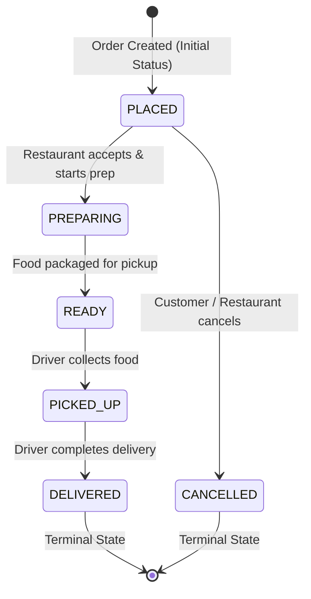

# Feature Specification: TrackC — Live Order Tracking (MVP)

**Feature Identifier**: `TrackC`  
**Status**: In Review (Draft Specification)  
**Target Release**: MiniDash v1.1.0  
**Authors**: MiniDash Core Team  
**Scope**: Tiny Minimum Viable Product (MVP)  

---

## 1. Executive Summary & Objective

The **TrackC: Live Order Tracking** feature enables customers to track their order lifecycle in real time from placement to delivery. This specification establishes a deterministic, transition-safe state machine, persists an auditable status history, provides dynamic Estimated Time of Arrival (ETA) calculations, and offers real-time order tracking via polling and Server-Sent Events (SSE), accompanied by a developer/driver simulation script.

In accordance with strict MVP principles, this release defines the minimal viable scope necessary to fulfill end-to-end live tracking without introducing third-party dependencies, map SDKs, or cloud services.

---

## 2. Scope & Guardrails (Strict MVP Boundaries)

To keep the implementation lightweight, focused, and maintainable, clear boundaries are defined between in-scope deliverables and non-goals.

### 2.1 In-Scope (Minimum Viable Scope)
- **Lifecycle Finite State Machine (FSM)**: Replace baseline unstructured status values with an enforced lifecycle:
  `PLACED` $\rightarrow$ `PREPARING` $\rightarrow$ `READY` $\rightarrow$ `PICKED_UP` $\rightarrow$ `DELIVERED`.
- **Cancellation Rule**: `CANCELLED` is strictly permitted **only before `PREPARING`** (i.e., only while in `PLACED`).
- **State Transition Guard**: Any transition attempt violating the state machine returns an HTTP 400 Bad Request error and leaves database state completely unchanged.
- **Audit History Persistence**: Every status change (including initial creation) is recorded in a new `order_status_history` table with UTC ISO 8601 timestamps.
- **Tracking Endpoint (`GET /orders/{id}/tracking`)**: Exposes current status, ETA, and chronological status history.
- **Deterministic ETA Model**: Computes arrival time using the restaurant's `avg_prep_minutes` and a simplified deterministic distance transit model, recomputed upon every valid status change.
- **Live Updates**:
  1. Polling via `GET /orders/{id}/tracking`.
  2. Server-Sent Events (SSE) streaming via `GET /orders/{id}/tracking/stream`.
- **Simulation Script**: A standalone CLI script (`scripts/simulate_driver.py`) that steps an order sequentially through the lifecycle with configurable time delays to simulate real-world driver advancement.

### 2.2 Out-of-Scope (Non-Goals for this MVP)
- Real-time GPS device coordinates, telemetry streams, or driver location pings.
- Map rendering, mapping SDK integrations (Google Maps, Leaflet, Mapbox), or polyline routing.
- Real-world traffic congestion APIs, dynamic road network calculation, or weather adjustments.
- Push notifications (APNS, FCM, SMS, Email, or WebPush).
- Driver dispatch algorithms, multi-order batching, or driver authentication/payroll.
- External messaging brokers (Redis, RabbitMQ, Kafka) or distributed WebSocket clusters.

---

## 3. Order Lifecycle Finite State Machine (FSM)

### 3.1 State Diagram



### 3.2 State Transition Matrix

| Current State | Allowed Next State(s) | Disallowed Transitions (Return 400 Bad Request) |
| :--- | :--- | :--- |
| **`PLACED`** (Initial) | `PREPARING`, `CANCELLED` | `READY`, `PICKED_UP`, `DELIVERED`, `PLACED` |
| **`PREPARING`** | `READY` | `PLACED`, `PICKED_UP`, `DELIVERED`, `CANCELLED`, `PREPARING` |
| **`READY`** | `PICKED_UP` | `PLACED`, `PREPARING`, `DELIVERED`, `CANCELLED`, `READY` |
| **`PICKED_UP`** | `DELIVERED` | `PLACED`, `PREPARING`, `READY`, `CANCELLED`, `PICKED_UP` |
| **`DELIVERED`** (Terminal) | None | All transitions rejected (immutable) |
| **`CANCELLED`** (Terminal) | None | All transitions rejected (immutable) |

---

## 4. Estimated Time of Arrival (ETA) Calculation

### 4.1 Minimalist Distance & Travel Model
For this MVP, delivery transit time is modeled deterministically without external mapping dependencies:
- **Baseline Transit Time ($T_{\text{transit}}$)**: Fixed at **15 minutes** (standard municipal delivery radius).
- **Restaurant Prep Time ($T_{\text{prep}}$)**: Sourced directly from `restaurants.avg_prep_minutes`.

### 4.2 State-Dependent ETA Computation Rules
Upon every valid transition timestamp $t_{\text{current}}$, the estimated arrival time is recalculated as follows:

| Order Status | Remaining Prep Time | Remaining Transit Time | Calculated Estimated Arrival Time ($\text{ETA}$) |
| :--- | :--- | :--- | :--- |
| **`PLACED`** | $T_{\text{prep}}$ | $T_{\text{transit}}$ (15 min) | $t_{\text{created}} + T_{\text{prep}} + T_{\text{transit}}$ |
| **`PREPARING`** | $T_{\text{prep}}$ | $T_{\text{transit}}$ (15 min) | $t_{\text{current}} + T_{\text{prep}} + T_{\text{transit}}$ |
| **`READY`** | $0$ (Complete) | $T_{\text{transit}}$ (15 min) | $t_{\text{current}} + T_{\text{transit}}$ |
| **`PICKED_UP`** | $0$ (Complete) | $T_{\text{transit}}$ (15 min) | $t_{\text{current}} + T_{\text{transit}}$ |
| **`DELIVERED`** | $0$ | $0$ | $t_{\text{current}}$ (Actual delivered time) |
| **`CANCELLED`** | N/A | N/A | `null` |

All timestamps are stored and formatted in **ISO 8601 UTC** with timezone offset (e.g., `2026-10-29T16:45:00Z`).

---

## 5. User Stories & Acceptance Criteria (EARS Syntax)

Acceptance criteria are specified using the **Easy Approach to Requirements Syntax (EARS)**:
- **Ubiquitous**: `The <system> shall <action>.`
- **Event-driven**: `When <trigger>, the <system> shall <action>.`
- **State-driven**: `While <state>, the <system> shall <action>.`
- **Unwanted Behavior**: `If <condition>, then the <system> shall <action>.`
- **Optional Feature**: `Where <feature>, the <system> shall <action>.`
- **Compound**: `While <state>, when <trigger>, the <system> shall <action>.`

---

### User Story 1: View Order Tracking & Status History (Customer)
> **As a** customer who placed an order,  
> **I want to** view the current status, status change history, and estimated arrival time,  
> **So that** I know exactly where my food is and when it will arrive.

#### Acceptance Criteria (EARS)
- **AC-1.1 [Event-driven]**: When a client sends a `GET` request to `/orders/{id}/tracking` for a valid order, the MiniDash API shall return HTTP `200 OK` with the order's `order_id`, `current_status`, `estimated_arrival_at`, and the chronological list of all recorded `history` entries.
- **AC-1.2 [Ubiquitous]**: The MiniDash API shall include a `status` and an ISO 8601 UTC `timestamp` for each record in the tracking `history` array, sorted in ascending chronological order.
- **AC-1.3 [Unwanted Behavior]**: If a client requests tracking for an order ID that does not exist in the database, then the MiniDash API shall return HTTP `404 Not Found` with an informative error payload and execute no further actions.

---

### User Story 2: Strict Lifecycle State Progression (Operations & Delivery)
> **As an** operations supervisor or delivery driver,  
> **I want** the system to enforce strict order lifecycle transitions,  
> **So that** orders cannot skip essential steps or undergo invalid status changes.

#### Acceptance Criteria (EARS)
- **AC-2.1 [Ubiquitous]**: When a new order is placed via `POST /orders`, the MiniDash API shall initialize the order's status to `PLACED` and record an initial status history entry with the creation timestamp.
- **AC-2.2 [Compound]**: While an order is in the `PLACED` state, when a request is made to `PATCH /orders/{id}/status` with status `PREPARING` or `CANCELLED`, the MiniDash API shall update the order status, append an entry to the status history, and return HTTP `200 OK`.
- **AC-2.3 [Compound]**: While an order is in the `PREPARING` state, when a request is made to `PATCH /orders/{id}/status` with status `READY`, the MiniDash API shall update the order status, append an entry to the status history, and return HTTP `200 OK`.
- **AC-2.4 [Compound]**: While an order is in the `READY` state, when a request is made to `PATCH /orders/{id}/status` with status `PICKED_UP`, the MiniDash API shall update the order status, append an entry to the status history, and return HTTP `200 OK`.
- **AC-2.5 [Compound]**: While an order is in the `PICKED_UP` state, when a request is made to `PATCH /orders/{id}/status` with status `DELIVERED`, the MiniDash API shall update the order status, append an entry to the status history, and return HTTP `200 OK`.
- **AC-2.6 [Unwanted Behavior]**: If a client requests a status transition that skips a stage in the lifecycle (such as `PLACED` $\rightarrow$ `READY` or `PREPARING` $\rightarrow$ `DELIVERED`), then the MiniDash API shall reject the request with HTTP `400 Bad Request`, retain the existing status, and record no history entry.
- **AC-2.7 [Unwanted Behavior]**: If a client requests status `CANCELLED` when the order is in `PREPARING`, `READY`, `PICKED_UP`, or `DELIVERED`, then the MiniDash API shall reject the request with HTTP `400 Bad Request`, retain the existing status, and record no history entry.
- **AC-2.8 [Unwanted Behavior]**: If a client attempts to update an order that is already in `DELIVERED` or `CANCELLED`, then the MiniDash API shall reject the request with HTTP `400 Bad Request` and make no modifications.
- **AC-2.9 [Unwanted Behavior]**: If a client supplies an unrecognized status string, then the MiniDash API shall return HTTP `400 Bad Request` listing the valid statuses.

---

### User Story 3: Recompute Arrival Time on Lifecycle Milestones (Customer)
> **As a** customer waiting for my meal,  
> **I want** the estimated arrival time to update whenever the order status advances,  
> **So that** I receive accurate, up-to-date arrival estimates reflecting actual progress.

#### Acceptance Criteria (EARS)
- **AC-3.1 [Event-driven]**: When an order transitions to `PLACED` or `PREPARING`, the MiniDash API shall recompute `estimated_arrival_at` by adding `avg_prep_minutes` and 15 minutes of transit time to the transition timestamp.
- **AC-3.2 [Event-driven]**: When an order transitions to `READY` or `PICKED_UP`, the MiniDash API shall recompute `estimated_arrival_at` by adding 15 minutes of transit time to the transition timestamp.
- **AC-3.3 [State-driven]**: While an order has the status `DELIVERED`, the `estimated_arrival_at` attribute shall equal the final delivery timestamp recorded in history.
- **AC-3.4 [State-driven]**: While an order has the status `CANCELLED`, the `estimated_arrival_at` attribute shall be `null`.
- **AC-3.5 [Ubiquitous]**: The MiniDash API shall persist the updated `estimated_arrival_at` alongside the order record so that subsequent tracking requests return the latest calculation.

---

### User Story 4: Live Order Updates via Server-Sent Events (Customer & Client Apps)
> **As a** frontend web client or mobile application,  
> **I want to** establish a persistent event stream for an active order,  
> **So that** I can push instantaneous UI updates to the customer without aggressive polling.

#### Acceptance Criteria (EARS)
- **AC-4.1 [Optional / Event-driven]**: Where a client sends a `GET` request to `/orders/{id}/tracking/stream`, the MiniDash API shall return a response with `Content-Type: text/event-stream`, `Cache-Control: no-cache`, and `Connection: keep-alive`.
- **AC-4.2 [Event-driven]**: When a client successfully connects to `/orders/{id}/tracking/stream`, the MiniDash API shall immediately emit the current tracking state as the first event.
- **AC-4.3 [Event-driven]**: When the order status is updated, the MiniDash API shall push a new event containing the serialized tracking payload to all active SSE subscribers for that order.
- **AC-4.4 [State-driven]**: While an order reaches a terminal state (`DELIVERED` or `CANCELLED`), the MiniDash API shall emit the terminal status event and terminate the SSE connection stream.
- **AC-4.5 [Unwanted Behavior]**: If a client requests an SSE stream for an order ID that does not exist, then the MiniDash API shall return HTTP `404 Not Found`.

---

### User Story 5: Driver Advancement Simulator (Developer & QA)
> **As a** developer or quality assurance engineer,  
> **I want a** lightweight simulation script,  
> **So that** I can automatically advance an order through all delivery states to verify live tracking.

#### Acceptance Criteria (EARS)
- **AC-5.1 [Event-driven]**: When executed from the command line with `--order-id <ID>`, the simulation script shall sequentially advance the order through the remaining valid states (`PREPARING` $\rightarrow$ `READY` $\rightarrow$ `PICKED_UP` $\rightarrow$ `DELIVERED`).
- **AC-5.2 [Ubiquitous]**: The simulation script shall pause for a configurable delay (defaulting to 3 seconds, overrideable via `--delay <seconds>`) between consecutive status updates.
- **AC-5.3 [Ubiquitous]**: The simulation script shall print readable console logs displaying timestamp, order ID, advanced status, and calculated ETA after each transition.
- **AC-5.4 [Unwanted Behavior]**: If the designated order is already in a terminal state (`DELIVERED` or `CANCELLED`), then the simulation script shall output a diagnostic message and exit with a non-zero exit code without dispatching update calls.

---

## 6. Technical Specifications & Interface Contracts

### 6.1 Database Schema Extensions

To support status history and persistent ETA tracking in SQLite:

```sql
-- Status history table tracking every transition event
CREATE TABLE IF NOT EXISTS order_status_history (
    id INTEGER PRIMARY KEY AUTOINCREMENT,
    order_id INTEGER NOT NULL,
    status TEXT NOT NULL,
    timestamp TEXT NOT NULL,
    FOREIGN KEY (order_id) REFERENCES orders (id) ON DELETE CASCADE
);

CREATE INDEX IF NOT EXISTS idx_order_status_history_order_id 
ON order_status_history (order_id);
```

> **Note on `orders` Table**:
> - New orders created will default to status `'PLACED'` (superseding the baseline placeholder `'PENDING'`).
> - A column `estimated_arrival_at TEXT` will be maintained on `orders` (or calculated deterministically).

---

### 6.2 HTTP API Contracts

#### Endpoint 1: Retrieve Live Tracking
- **Method & Path**: `GET /orders/{id}/tracking`
- **Success Response (200 OK)**:
```json
{
  "order_id": 1,
  "current_status": "PREPARING",
  "estimated_arrival_at": "2026-10-29T12:55:00+00:00",
  "history": [
    {
      "status": "PLACED",
      "timestamp": "2026-10-29T12:20:00+00:00"
    },
    {
      "status": "PREPARING",
      "timestamp": "2026-10-29T12:25:00+00:00"
    }
  ]
}
```
- **Error Responses**:
  - `404 Not Found`: `{"detail": "Order with id 1 not found"}`

---

#### Endpoint 2: Live Tracking Event Stream (SSE)
- **Method & Path**: `GET /orders/{id}/tracking/stream`
- **Headers**:
  - `Content-Type: text/event-stream`
  - `Cache-Control: no-cache`
  - `Connection: keep-alive`
- **Event Payload**:
```
event: tracking_update
data: {"order_id":1,"current_status":"PREPARING","estimated_arrival_at":"2026-10-29T12:55:00+00:00","history":[{"status":"PLACED","timestamp":"2026-10-29T12:20:00+00:00"},{"status":"PREPARING","timestamp":"2026-10-29T12:25:00+00:00"}]}

```

---

#### Endpoint 3: Update Order Status (Enforced State Machine)
- **Method & Path**: `PATCH /orders/{id}/status`
- **Request Body**:
```json
{
  "status": "PREPARING"
}
```
- **Success Response (200 OK)**: Returns updated order object.
- **Error Responses**:
  - `400 Bad Request`: `{"detail": "Cannot transition order 1 from PLACED to READY. Allowed next statuses: PREPARING, CANCELLED"}`
  - `400 Bad Request`: `{"detail": "Cannot cancel order 1 in status PREPARING. Cancellation is only permitted when PLACED"}`
  - `404 Not Found`: `{"detail": "Order with id 1 not found"}`

---

### 6.3 Simulation Script CLI Contract
- **File**: `scripts/simulate_driver.py`
- **Usage**:
  ```bash
  python scripts/simulate_driver.py --order-id 1 [--delay 3] [--base-url http://127.0.0.1:8000]
  ```
- **Console Output Example**:
  ```text
  [MiniDash Driver Simulation] Starting simulation for Order #1
  Current Status: PLACED (ETA: 2026-10-29T12:55:00+00:00)
  --> Advancing to PREPARING... OK (ETA: 2026-10-29T13:00:00+00:00)
  (Waiting 3s)
  --> Advancing to READY... OK (ETA: 2026-10-29T12:45:00+00:00)
  (Waiting 3s)
  --> Advancing to PICKED_UP... OK (ETA: 2026-10-29T12:45:00+00:00)
  (Waiting 3s)
  --> Advancing to DELIVERED... OK (Completed at: 2026-10-29T12:30:09+00:00)
  [MiniDash Driver Simulation] Order #1 reached terminal status DELIVERED. Simulation complete.
  ```

---

## 7. Quality Assurance & Verification Plan

1. **State Machine Invariant Testing**:
   - Verify every valid transition path from `PLACED` to `DELIVERED`.
   - Verify valid cancellation path (`PLACED` $\rightarrow$ `CANCELLED`).
   - Attempt all invalid combinations (backward, skip, cancelled after prep, post-terminal updates) and verify HTTP 400 with pristine database state rollback.
2. **Audit History Verification**:
   - Ensure count and timestamp ordering of history records match each status update.
3. **ETA Calculation Testing**:
   - Verify expected ETA mathematically against fixture restaurant prep times (e.g. Burger Haven: 20 min prep + 15 min travel = 35 min).
   - Verify ETA updates when moving from `PREPARING` to `READY` (drops prep time component).
4. **SSE & Polling Verification**:
   - Verify both short polling and SSE streaming payloads.
5. **Simulation End-to-End Test**:
   - Run simulator against test server and verify order finishes in `DELIVERED` state.
