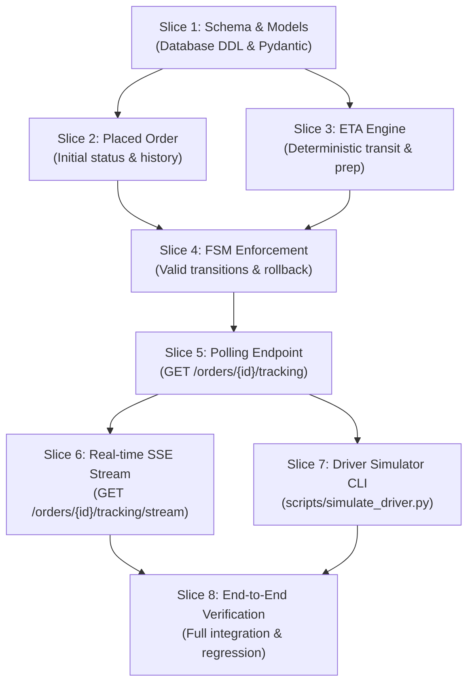

# Implementation Plan: TrackC — Live Order Tracking (MVP)

**Feature Identifier**: `TrackC`  
**Target Release**: MiniDash v1.1.0  
**Status**: Ready for Implementation  
**Specification Reference**: [`requirements.md`](requirements.md)  
**Architectural Design Reference**: [`design.md`](design.md)  
**Authors**: MiniDash Core Team  

---

## 1. Overview & Slicing Strategy

This document defines the actionable, test-driven implementation plan for **TrackC: Live Order Tracking (MVP)**. Following agile slicing principles, the feature is decomposed into **eight ordered, minimal, test-verifiable slices**.

Each slice represents a thin, cohesive increment that:
1. Implements a focused portion of functionality across the layered architecture.
2. Preserves backwards compatibility and prevents regressions in existing endpoints.
3. Is verified by dedicated automated tests before advancing to the subsequent slice.
4. Directly satisfies a designated subset of the EARS Acceptance Criteria defined in `requirements.md`.

---

## 2. Traceability Matrix & Slice Summary

| Slice | Title | Target Requirements | Files Touched / Created | Verifying Test Suite |
| :--- | :--- | :--- | :--- | :--- |
| **Slice 1** | **Database Schema & Tracking Data Models** | AC-1.2, AC-2.1 (data layer) | `app/database.py`, `app/schemas/order.py` | `tests/test_schema.py` |
| **Slice 2** | **Initial Order Placement (`PLACED`) & History Entry** | AC-2.1 | `app/repository/order_repo.py`, `app/services/order_service.py`, `tests/test_orders.py` | `tests/test_orders.py` |
| **Slice 3** | **Deterministic ETA Calculation Engine** | AC-3.1, AC-3.2, AC-3.3, AC-3.4, AC-3.5 | `app/services/eta_calculator.py` (new) | `tests/test_eta.py` (new) |
| **Slice 4** | **Finite State Machine (FSM) & Atomic Status Updates** | AC-2.2, AC-2.3, AC-2.4, AC-2.5, AC-2.6, AC-2.7, AC-2.8, AC-2.9 | `app/services/order_service.py`, `app/repository/order_repo.py` | `tests/test_fsm.py` (new) |
| **Slice 5** | **Live Tracking Snapshot & Polling Endpoint** | AC-1.1, AC-1.2, AC-1.3 | `app/routes/order_routes.py`, `app/services/order_service.py`, `app/repository/order_repo.py` | `tests/test_tracking.py` (new) |
| **Slice 6** | **In-Memory Broadcaster & Server-Sent Events (SSE)** | AC-4.1, AC-4.2, AC-4.3, AC-4.4, AC-4.5 | `app/services/broadcaster.py` (new), `app/routes/order_routes.py`, `app/services/order_service.py` | `tests/test_sse.py` (new) |
| **Slice 7** | **Driver Advancement Simulator CLI** | AC-5.1, AC-5.2, AC-5.3, AC-5.4 | `scripts/simulate_driver.py` (new) | `tests/test_simulator.py` (new) |
| **Slice 8** | **End-to-End Tracking Lifecycle & Regression Suite** | AC-1.1 – AC-5.4 (Complete) | Full stack integration | `tests/test_e2e_tracking.py` (new) |



---

## 3. Detailed Slices and Verification Tests

---

### Slice 1: Database Schema & Tracking Data Models

#### 1. Objective & Scope
Establish the relational schema and Pydantic validation structures required for status history and ETA persistence without altering existing table primary keys or corrupting existing test fixtures.

#### 2. Acceptance Criteria Covered
- **AC-1.2 [Ubiquitous]**: Tracking history stores status and ISO 8601 UTC timestamp.
- **AC-2.1 [Foundation]**: Database and models support `PLACED` lifecycle status.

#### 3. Components & Files Touched
- `app/database.py`:
  - Add `order_status_history` DDL with foreign key referencing `orders(id)` and `ON DELETE CASCADE`.
  - Add index `idx_order_status_history_order_id` on `order_status_history(order_id)`.
  - Add idempotent column migration in `init_db()`: check `PRAGMA table_info(orders);` and run `ALTER TABLE orders ADD COLUMN estimated_arrival_at TEXT;` if absent.
- `app/schemas/order.py`:
  - Define `OrderStatus(str, Enum)` with members: `PLACED`, `PREPARING`, `READY`, `PICKED_UP`, `DELIVERED`, `CANCELLED`.
  - Define `TrackingHistoryItem(BaseModel)` with `status: OrderStatus` and `timestamp: str`.
  - Define `OrderTrackingResponse(BaseModel)` with `order_id: int`, `current_status: OrderStatus`, `estimated_arrival_at: Optional[str]`, and `history: List[TrackingHistoryItem]`.
  - Extend `OrderResponse` to include `estimated_arrival_at: Optional[str] = None` and type `status: OrderStatus`.

#### 4. Test That Will Verify It
- **Test File**: `tests/test_schema.py`
- **Execution Command**:
  ```bash
  .venv/bin/pytest tests/test_schema.py -v
  ```
- **Test Cases**:
  1. `test_order_status_history_table_exists(db_conn)`:
     - Queries `sqlite_master` for table `order_status_history`.
     - Verifies column structure: `id` (INTEGER, PK), `order_id` (INTEGER, NOT NULL), `status` (TEXT, NOT NULL), `timestamp` (TEXT, NOT NULL).
     - Queries `PRAGMA index_list('order_status_history');` and verifies `idx_order_status_history_order_id` exists.
  2. `test_orders_table_has_estimated_arrival_at_column(db_conn)`:
     - Queries `PRAGMA table_info(orders);` and asserts `estimated_arrival_at` column is present with `TEXT` type.
  3. `test_order_status_enum_and_schemas()`:
     - Instantiates `OrderStatus` with all valid statuses and asserts exact string values.
     - Validates that invalid status string raises `ValidationError` in Pydantic.
     - Serializes and deserializes `OrderTrackingResponse` and `TrackingHistoryItem` ensuring valid ISO timestamps.

---

### Slice 2: Initial Order Placement (`PLACED`) & History Entry

#### 2. Objective & Scope
Transition initial order creation from the legacy `'PENDING'` placeholder to the formal FSM initial state `'PLACED'`. Ensure every created order atomically records its initial snapshot in `order_status_history` inside the same database transaction.

#### 2. Acceptance Criteria Covered
- **AC-2.1 [Ubiquitous]**: When a new order is placed via `POST /orders`, the MiniDash API shall initialize the order's status to `PLACED` and record an initial status history entry with the creation timestamp.

#### 3. Components & Files Touched
- `app/repository/order_repo.py`:
  - In `create_order(...)`, insert order with `status='PLACED'`.
  - Within the same `with self.conn:` transaction block, insert `(order_id, 'PLACED', created_at)` into `order_status_history`.
- `app/services/order_service.py`:
  - Update `initial_status` from `"PENDING"` to `"PLACED"`.
- `tests/test_orders.py`:
  - Update baseline test assertion expecting `"PENDING"` to expect `"PLACED"`.

#### 4. Test That Will Verify It
- **Test File**: `tests/test_orders.py`
- **Execution Command**:
  ```bash
  .venv/bin/pytest tests/test_orders.py -k "test_create_order" -v
  ```
- **Test Cases**:
  1. `test_create_order_initializes_placed_and_records_history(client, db_conn)`:
     - Sends `POST /orders` with valid restaurant and menu items.
     - Asserts response status `201 Created` and `response.json()["status"] == "PLACED"`.
     - Directly queries `order_status_history` in `db_conn` where `order_id = created_id`.
     - Asserts exactly 1 row returned with `status == "PLACED"` and `timestamp == response.json()["created_at"]`.
  2. `test_create_order_transactional_rollback(client, monkeypatch)`:
     - Simulates an error inserting into `order_status_history`.
     - Verifies transaction aborts: neither the `orders` row nor partial `order_items` remain persisted.

---

### Slice 3: Deterministic ETA Calculation Engine

#### 1. Objective & Scope
Implement the pure business logic service for deterministic ETA calculation based on restaurant preparation times (`avg_prep_minutes`) and municipal delivery transit time (fixed at 15 minutes).

#### 2. Acceptance Criteria Covered
- **AC-3.1 [Event-driven]**: Transitions to `PLACED` or `PREPARING` add `avg_prep_minutes` + 15 min.
- **AC-3.2 [Event-driven]**: Transitions to `READY` or `PICKED_UP` add 15 min transit time.
- **AC-3.3 [State-driven]**: In `DELIVERED`, ETA equals the delivery timestamp.
- **AC-3.4 [State-driven]**: In `CANCELLED`, ETA is `None` (`null`).
- **AC-3.5 [Ubiquitous]**: Timestamps are properly computed in ISO 8601 UTC format.

#### 3. Components & Files Touched
- `app/services/eta_calculator.py` (New module):
  - Function `calculate_eta(status: OrderStatus, transition_time: datetime, avg_prep_minutes: int) -> Optional[str]`
  - Implements the mathematical formulas:
    - $\text{ETA}_{\text{PLACED}} = t + T_{\text{prep}} + 15\text{ min}$
    - $\text{ETA}_{\text{PREPARING}} = t + T_{\text{prep}} + 15\text{ min}$
    - $\text{ETA}_{\text{READY}} = t + 15\text{ min}$
    - $\text{ETA}_{\text{PICKED\_UP}} = t + 15\text{ min}$
    - $\text{ETA}_{\text{DELIVERED}} = t$
    - $\text{ETA}_{\text{CANCELLED}} = \text{None}$
  - Formats output via `.isoformat()` with explicit UTC offset (`+00:00` or `Z`).

#### 4. Test That Will Verify It
- **Test File**: `tests/test_eta.py`
- **Execution Command**:
  ```bash
  .venv/bin/pytest tests/test_eta.py -v
  ```
- **Test Cases**:
  1. `test_calculate_eta_placed_and_preparing()`:
     - Fixed anchor timestamp `2026-10-29T12:00:00Z`, `avg_prep_minutes = 20`.
     - Asserts ETA is `2026-10-29T12:35:00+00:00` (20m prep + 15m transit).
  2. `test_calculate_eta_ready_and_picked_up()`:
     - Anchor timestamp `2026-10-29T12:20:00Z`, `avg_prep_minutes = 20`.
     - Asserts ETA is `2026-10-29T12:35:00+00:00` (drops prep time, adds 15m transit).
  3. `test_calculate_eta_delivered()`:
     - Anchor timestamp `2026-10-29T12:34:50Z`.
     - Asserts ETA equals anchor timestamp `2026-10-29T12:34:50+00:00`.
  4. `test_calculate_eta_cancelled()`:
     - Asserts ETA is `None`.

---

### Slice 4: Finite State Machine (FSM) & Atomic Status Updates

#### 1. Objective & Scope
Enforce strict lifecycle transitions when clients update an order via `PATCH /orders/{id}/status`. Validate transitions against the state transition matrix, recalculate ETA eagerly, append to `order_status_history`, and guarantee that invalid transitions reject with HTTP 400 without corrupting database state.

#### 2. Acceptance Criteria Covered
- **AC-2.2, AC-2.3, AC-2.4, AC-2.5 [Compound]**: Valid progression (`PLACED` $\rightarrow$ `PREPARING` $\rightarrow$ `READY` $\rightarrow$ `PICKED_UP` $\rightarrow$ `DELIVERED`, and `PLACED` $\rightarrow$ `CANCELLED`).
- **AC-2.6 [Unwanted Behavior]**: Stage skipping (`PLACED` $\rightarrow$ `READY`, `PREPARING` $\rightarrow$ `DELIVERED`) rejected with HTTP 400.
- **AC-2.7 [Unwanted Behavior]**: Cancellation after preparation (`PREPARING` $\rightarrow$ `CANCELLED`) rejected with HTTP 400.
- **AC-2.8 [Unwanted Behavior]**: Modifications to terminal states (`DELIVERED`, `CANCELLED`) rejected with HTTP 400.
- **AC-2.9 [Unwanted Behavior]**: Unrecognized status strings rejected with HTTP 400 listing valid statuses.
- **AC-3.5 [Ubiquitous]**: Persist updated `estimated_arrival_at` on order.

#### 3. Components & Files Touched
- `app/repository/order_repo.py`:
  - Add `update_status_and_eta(order_id: int, status: str, estimated_arrival_at: Optional[str], timestamp: str) -> Optional[dict]`.
  - Atomically updates `orders (status, estimated_arrival_at)` and inserts `order_status_history (order_id, status, timestamp)`.
- `app/services/order_service.py`:
  - Define `VALID_TRANSITIONS` mapping:
    ```python
    VALID_TRANSITIONS = {
        OrderStatus.PLACED: {OrderStatus.PREPARING, OrderStatus.CANCELLED},
        OrderStatus.PREPARING: {OrderStatus.READY},
        OrderStatus.READY: {OrderStatus.PICKED_UP},
        OrderStatus.PICKED_UP: {OrderStatus.DELIVERED},
        OrderStatus.DELIVERED: set(),
        OrderStatus.CANCELLED: set(),
    }
    ```
  - Validate transition; raise `ValidationError` (mapped to HTTP 400) on invalid jumps, illegal cancellations, or terminal edits.
  - Coordinate with `RestaurantRepository` to obtain `avg_prep_minutes` and invoke `calculate_eta`.
- `app/routes/order_routes.py`:
  - Keep route handler pointing to updated `OrderService.update_order_status`.

#### 4. Test That Will Verify It
- **Test File**: `tests/test_fsm.py`
- **Execution Command**:
  ```bash
  .venv/bin/pytest tests/test_fsm.py -v
  ```
- **Test Cases**:
  1. `test_fsm_happy_path_lifecycle(client)`:
     - Steps an order through `PLACED` $\rightarrow$ `PREPARING` $\rightarrow$ `READY` $\rightarrow$ `PICKED_UP` $\rightarrow$ `DELIVERED`.
     - Asserts HTTP 200 for each patch and verifies `estimated_arrival_at` updates at each stage.
  2. `test_fsm_cancellation_allowed_only_in_placed(client)`:
     - Order in `PLACED` transitions to `CANCELLED` $\rightarrow$ HTTP 200.
     - New order transitioned to `PREPARING`, then attempts `CANCELLED` $\rightarrow$ HTTP 400 with detail: *"Cannot cancel order ... Cancellation is only permitted when PLACED"*.
  3. `test_fsm_rejects_skipping_stages(client, db_conn)`:
     - Attempts `PLACED` $\rightarrow$ `READY` $\rightarrow$ HTTP 400.
     - Asserts database status remains `PLACED` and `order_status_history` contains only the initial creation row.
  4. `test_fsm_rejects_terminal_state_modifications(client)`:
     - Order in `DELIVERED` attempts `PATCH` to `PICKED_UP` or `CANCELLED` $\rightarrow$ HTTP 400.
     - Order in `CANCELLED` attempts `PATCH` to `PREPARING` $\rightarrow$ HTTP 400.
  5. `test_fsm_rejects_invalid_status_string(client)`:
     - `PATCH /orders/1/status` with `{"status": "COOKING"}` $\rightarrow$ HTTP 400 listing valid statuses.

---

### Slice 5: Live Tracking Snapshot & Polling Endpoint

#### 1. Objective & Scope
Implement the polling endpoint `GET /orders/{id}/tracking` that returns the live snapshot of an order: its current status, current estimated arrival time, and full chronological history log with UTC timestamps.

#### 2. Acceptance Criteria Covered
- **AC-1.1 [Event-driven]**: `GET /orders/{id}/tracking` returns HTTP 200 with `order_id`, `current_status`, `estimated_arrival_at`, and chronological `history`.
- **AC-1.2 [Ubiquitous]**: Each record in `history` includes `status` and ISO 8601 UTC `timestamp` sorted ascending.
- **AC-1.3 [Unwanted Behavior]**: Requesting tracking for a non-existent order ID returns HTTP 404 Not Found.

#### 3. Components & Files Touched
- `app/repository/order_repo.py`:
  - Add `get_tracking(order_id: int) -> Optional[dict]`:
    - Queries `orders` for `status` and `estimated_arrival_at`.
    - Queries `order_status_history` where `order_id = ?` ordered by `id ASC`.
- `app/services/order_service.py`:
  - Add `get_order_tracking(order_id: int) -> OrderTrackingResponse`.
  - Raises `NotFoundError` if order does not exist.
- `app/routes/order_routes.py`:
  - Add endpoint:
    ```python
    @router.get("/{id}/tracking", response_model=OrderTrackingResponse)
    def get_order_tracking(id: int, service: OrderService = Depends(get_order_service)):
        return service.get_order_tracking(id)
    ```

#### 4. Test That Will Verify It
- **Test File**: `tests/test_tracking.py`
- **Execution Command**:
  ```bash
  .venv/bin/pytest tests/test_tracking.py -v
  ```
- **Test Cases**:
  1. `test_get_tracking_success_chronological_history(client)`:
     - Places an order (`PLACED`), advances to `PREPARING`, then `READY`.
     - Calls `GET /orders/{id}/tracking`.
     - Asserts HTTP 200.
     - Asserts `current_status == "READY"`.
     - Asserts `history` array has length 3, in chronological order: `PLACED`, `PREPARING`, `READY`.
     - Asserts each history item matches regex ISO 8601 UTC timestamp format.
  2. `test_get_tracking_not_found(client)`:
     - Calls `GET /orders/99999/tracking`.
     - Asserts HTTP 404 with error message: `Order with id 99999 not found`.
  3. `test_get_tracking_cancelled_order_has_null_eta(client)`:
     - Places order, cancels it, queries `/tracking`.
     - Asserts `current_status == "CANCELLED"` and `estimated_arrival_at is None`.

---

### Slice 6: In-Memory Broadcaster & Server-Sent Events (SSE) Streaming

#### 1. Objective & Scope
Introduce real-time push streaming via Server-Sent Events (`GET /orders/{id}/tracking/stream`) utilizing an in-memory `asyncio.Queue` Pub/Sub hub (ADR-001). Pushes the initial state immediately upon connection, dispatches real-time events whenever `PATCH /orders/{id}/status` commits, and closes cleanly upon reaching a terminal state.

#### 2. Acceptance Criteria Covered
- **AC-4.1 [Optional / Event-driven]**: SSE stream headers `Content-Type: text/event-stream`, `Cache-Control: no-cache`, `Connection: keep-alive`.
- **AC-4.2 [Event-driven]**: Immediately emits current tracking state as the first event upon connection.
- **AC-4.3 [Event-driven]**: Pushes new serialized tracking payload to active subscribers on status updates.
- **AC-4.4 [State-driven]**: Terminates connection cleanly when terminal state (`DELIVERED` or `CANCELLED`) is emitted.
- **AC-4.5 [Unwanted Behavior]**: Non-existent order ID returns HTTP 404.

#### 3. Components & Files Touched
- `app/services/broadcaster.py` (New module):
  - Class `OrderBroadcaster`:
    - `listeners: dict[int, set[asyncio.Queue]]`
    - `register_listener(order_id: int) -> asyncio.Queue`
    - `unregister_listener(order_id: int, queue: asyncio.Queue) -> None`
    - `broadcast(order_id: int, payload: dict) -> None`
- `app/services/order_service.py`:
  - Inject or access `OrderBroadcaster` singleton.
  - In `update_order_status`, call `broadcaster.broadcast(order_id, tracking_payload)`.
- `app/routes/order_routes.py`:
  - Add async route `GET /orders/{id}/tracking/stream`:
    - Checks order existence (returns 404 if missing).
    - Uses FastAPI `StreamingResponse(generator, media_type="text/event-stream")`.
    - Event frame format:
      ```text
      event: tracking_update
      data: <json_string>

      ```
    - Unregisters queue in `finally` block when client disconnects.

#### 4. Test That Will Verify It
- **Test File**: `tests/test_sse.py`
- **Execution Command**:
  ```bash
  .venv/bin/pytest tests/test_sse.py -v
  ```
- **Test Cases**:
  1. `test_sse_headers_and_initial_snapshot(async_client)`:
     - Connects to `/orders/{id}/tracking/stream`.
     - Asserts response header `content-type` starts with `text/event-stream`.
     - Reads first frame; asserts event name is `tracking_update` and payload contains `current_status: "PLACED"`.
  2. `test_sse_reactive_push_on_status_change(async_client, client)`:
     - Subscribes to stream in background task.
     - Synchronous client calls `PATCH /orders/{id}/status` to `"PREPARING"`.
     - Verifies subscriber receives second event frame with `current_status: "PREPARING"`.
  3. `test_sse_stream_closes_on_terminal_state(async_client, client)`:
     - Subscribes to order.
     - Advances order through to `"DELIVERED"`.
     - Verifies final `DELIVERED` frame is emitted and stream reader receives EOF / terminates.
  4. `test_sse_order_not_found(async_client)`:
     - Connects to `/orders/99999/tracking/stream`.
     - Asserts HTTP 404 Not Found.

---

### Slice 7: Driver Advancement Simulator CLI

#### 1. Objective & Scope
Build a standalone developer and QA CLI script (`scripts/simulate_driver.py`) that steps an order through remaining lifecycle states (`PREPARING` $\rightarrow$ `READY` $\rightarrow$ `PICKED_UP` $\rightarrow$ `DELIVERED`) with configurable delays and formatted console output.

#### 2. Acceptance Criteria Covered
- **AC-5.1 [Event-driven]**: Sequentially advances order through remaining valid states to `DELIVERED`.
- **AC-5.2 [Ubiquitous]**: Pauses for configurable delay (`--delay`, default 3s) between transitions.
- **AC-5.3 [Ubiquitous]**: Prints formatted console logs showing timestamp, order ID, advanced status, and ETA.
- **AC-5.4 [Unwanted Behavior]**: Exits with non-zero exit code if order is already `DELIVERED` or `CANCELLED`.

#### 3. Components & Files Touched
- `scripts/simulate_driver.py` (New executable script):
  - Uses `argparse` for `--order-id`, `--delay`, and `--base-url`.
  - Uses Python `urllib.request` or `http.client` (zero third-party dependencies required).
  - Fetches `GET /orders/{order_id}/tracking` to inspect current status.
  - Exits with return code 1 if order is already terminal (`DELIVERED` or `CANCELLED`) or missing.
  - Determines remaining state sequence and issues sequential `PATCH /orders/{order_id}/status` calls with `time.sleep(delay)`.
  - Exits with return code 0 upon successfully reaching `DELIVERED`.

#### 4. Test That Will Verify It
- **Test File**: `tests/test_simulator.py`
- **Execution Command**:
  ```bash
  .venv/bin/pytest tests/test_simulator.py -v
  ```
- **Test Cases**:
  1. `test_simulator_advances_placed_order_to_delivered(monkeypatch)`:
     - Places order in `PLACED` state.
     - Invokes `simulate_driver.run_simulation(order_id=id, delay=0.01, base_url=...)`.
     - Asserts function returns exit code 0.
     - Queries tracking endpoint and verifies final status is `DELIVERED` with all 5 history records present.
  2. `test_simulator_partial_advancement_from_ready(monkeypatch)`:
     - Sets order to `READY`.
     - Runs simulation with `order_id=id`.
     - Asserts only 2 remaining steps (`PICKED_UP`, `DELIVERED`) are dispatched.
  3. `test_simulator_fails_gracefully_on_terminal_order(capsys)`:
     - Places order and cancels it (`CANCELLED`).
     - Invokes simulation on the cancelled order.
     - Asserts return code is 1 and diagnostic message is logged to stderr/stdout.
  4. `test_simulator_fails_on_nonexistent_order()`:
     - Invokes simulation with `order_id=99999`.
     - Asserts return code is 1.

---

### Slice 8: End-to-End Tracking Lifecycle & Regression Suite

#### 1. Objective & Scope
Perform an end-to-end integration test across all TrackC features: placing an order, subscribing to the live SSE stream, running the driver simulator, observing synchronous and asynchronous state handoffs, verifying audit log integrity, and confirming no regressions across existing MiniDash endpoints.

#### 2. Acceptance Criteria Covered
- Validates **AC-1.1 through AC-5.4** together as an integrated system.

#### 3. Components & Files Touched
- `tests/test_e2e_tracking.py` (New integration test suite).
- All MiniDash modules (`database`, `routes`, `services`, `repository`, `schemas`).

#### 4. Test That Will Verify It
- **Test File**: `tests/test_e2e_tracking.py`
- **Execution Command**:
  ```bash
  .venv/bin/pytest tests/test_e2e_tracking.py -v
  ```
- **Test Cases**:
  1. `test_full_order_live_tracking_e2e()`:
     - Create order via `POST /orders`.
     - Verify initial status is `PLACED` and `order_status_history` has initial record.
     - Open SSE client connection to `/orders/{id}/tracking/stream`.
     - Receive initial event frame `PLACED`.
     - Run driver simulator advancement (`PREPARING` $\rightarrow$ `READY` $\rightarrow$ `PICKED_UP` $\rightarrow$ `DELIVERED`).
     - Verify SSE client receives all 4 subsequent event frames in exact order.
     - Verify ETA decreases and locks to final delivered timestamp.
     - Verify SSE connection closes upon `DELIVERED`.
     - Verify short-polling `GET /orders/{id}/tracking` reflects identical final state and complete history list.
  2. `test_existing_endpoints_regression()`:
     - Runs entire test suite (`pytest`) to ensure `test_restaurants.py`, `test_orders.py`, and `test_client.py` pass cleanly.

---

## 4. Execution Workflow & Definition of Done

### 4.1 Slice Development Cycle
For each slice $k \in [1, 8]$:
1. **Write the Test**: Implement the test cases in `tests/test_<slice>.py` asserting the required slice behaviors.
2. **Confirm Failure (Red)**: Run `pytest tests/test_<slice>.py` and verify test fails for expected reason.
3. **Implement Feature (Green)**: Write minimum code in `app/` to pass the tests.
4. **Refactor & Sanity Check**: Run full test suite:
   ```bash
   .venv/bin/pytest
   ```
   Ensure zero test regressions before proceeding to Slice $k+1$.

### 4.2 Definition of Done (DoD)
A slice is considered **Done** when:
- [ ] All designated unit and integration tests for that slice pass with 100% success.
- [ ] SQLite transactions guarantee atomicity (rollback on failure).
- [ ] No regression introduced to existing baseline tests (`tests/test_restaurants.py`, `tests/test_orders.py`).
- [ ] Code strictly complies with the layered architecture (Routes $\rightarrow$ Services $\rightarrow$ Repositories $\rightarrow$ SQLite).
- [ ] Documentation and type hints match Pydantic and FastAPI best practices.
